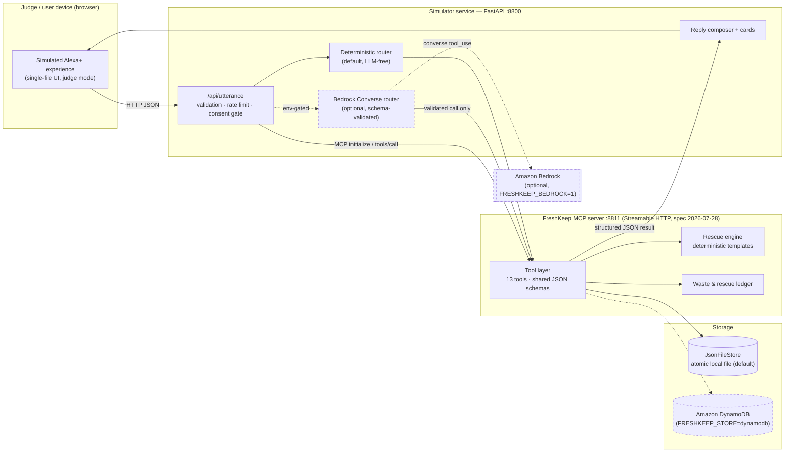
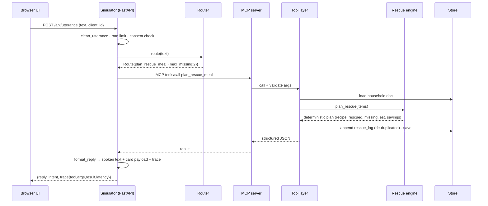

# FreshKeep — Architecture

## System diagram

## Sequence — one judge turn ("Plan a rescue meal")

## Component responsibilities

| Component | Responsibility |
|---|---|
| `simulator/app.py` | Permitted "simulated Alexa+ experience". Consent gate, rate limit, routing dispatch, reply composition, judge-mode trace. Speaks MCP as a *client*. |
| `router.py` | Regex/heuristic intent router. The critical demo path is 100% deterministic. |
| `bedrock.py` | Optional NL router via Bedrock Converse `tool_use`. Injection-hardened system prompt; validates tool name + arg types against `TOOL_SCHEMAS`; any failure → deterministic fallback; `delete_all_my_data` is explicitly not model-callable. |
| `mcpserver.py` | Self-hosted MCP server, Streamable HTTP, official SDK v2 (protocol 2026-07-28 ≥ required 2025-11-25). |
| `tools.py` | All tool logic + the JSON schemas shared by MCP server and Bedrock router (single source of truth). |
| `rescue.py` | Curated deterministic recipe templates. The planner never invents ingredients or actions. |
| `receipts.py` | Zero-effort entry: deterministic receipt-text parser (noise filtering, qty/unit/price extraction, store-header heuristic) + optional Amazon Textract adapter for photos. Items are only *proposed*; the user confirms, and tracking flows through the same `track_food` MCP tool. |
| `storage.py` | One document per household. `JsonFileStore` (atomic writes) for local/demo; `DynamoStore` (boto3, lazy import) for AWS. Same interface → swapping is one env var. |
| `safety.py` | Input validation, sliding-window rate limiter, PII-light audit log. |

## AWS usage — honest justification table

The core experience runs with **zero AWS services** (by design: reliable demo
anywhere). AWS services are real, documented integrations enabled by env vars:

| Service | Why necessary | What code calls it | Data processed | Failure handling | Cost control | Secrets/PII |
|---|---|---|---|---|---|---|
| Amazon Bedrock | Natural-language routing for messy real-world phrasings (beyond regex) | `bedrock.py` → `bedrock-runtime:Converse` (boto3) | Utterance text (≤500 chars) + tool schemas | 8s timeout, 1 retry, then deterministic fallback; flagged in trace | Cheapest Nova-class model, `maxTokens=400`, `temperature=0`, rate-limited ingress | No PII persisted; utterances never logged; creds via standard AWS chain only |
| Amazon DynamoDB | Durable multi-device household state beyond a local file | `storage.py:DynamoStore` | Household kitchen document (food items; no identity data) | boto3 retries; surfaced as safe error; JSON store as fallback config | On-demand capacity, single small doc per household | Table key is a household id, not a person; encryption at rest (AWS-managed) |
| Amazon Textract | Zero-effort grocery entry from receipt photos (opt-in) | `receipts.py` → `textract:DetectDocumentText` (boto3) | Receipt image bytes in transit; never stored, never logged | Extraction failure → friendly message + text-paste fallback | Per-page pricing, rate-limited ingress, 4 MB cap | Images pass through memory only; nothing persisted |
| Amazon CloudWatch (operational guidance) | Structured logs/alarms when deployed | logging → stdout (container/ECS picks it up) | Tool names, counts, latencies — never utterances | N/A | Default retention | Audit format excludes utterance text by design |

**Deliberately not used:** Cognito/API Gateway/S3/Lambda — the single-household
demo gains nothing from them; adding them would be decoration, which the brief
forbids. They are on the roadmap for multi-household production.

## Generative-AI policy (per brief)

- **Structured outputs:** Bedrock may only answer with `tool_use` blocks matching `TOOL_SCHEMAS`.
- **Validation:** unknown tools or wrong arg types are rejected before execution.
- **Fallback:** any model failure falls back to the deterministic router; the demo never depends on the model.
- **No hallucinated actions:** meal plans, expiry dates, and shopping items come from deterministic code, never from model text.
- **Generated vs verified:** all monetary figures are labeled *estimates*; estimated expiry dates are labeled *(estimate)* in UI.
- **No accuracy claims:** README/UI state estimates are not store prices.
